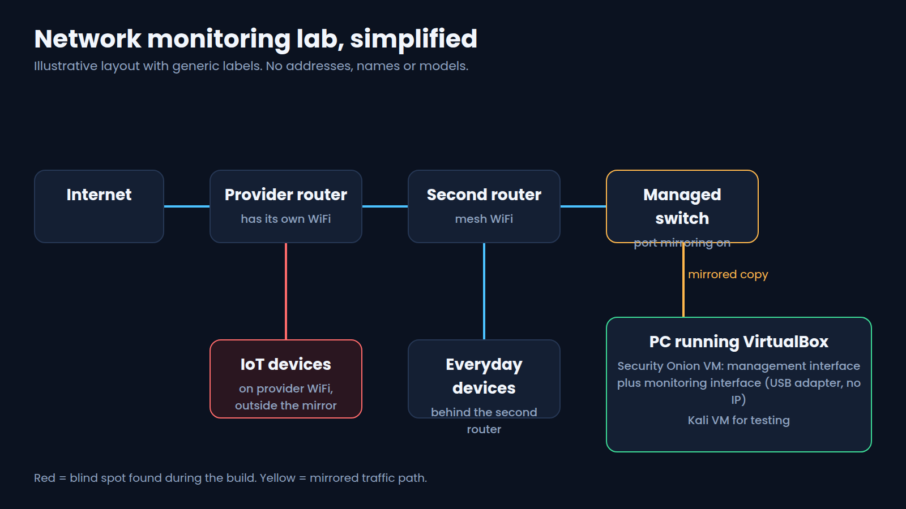

# Lab: Network monitoring with Security Onion

A home lab that turns a home network into something I can watch, with a free network security monitoring platform running in a virtual machine. This folder documents the design, the method, the lessons and the limits. It does not publish my network map.

## Goal

Detect and review what is happening on my own network, the way a small security team would: collect the traffic, read the alerts, decide what is normal, and fix what is not.

## What I built

Security Onion in a VirtualBox virtual machine on a Windows PC, next to a Kali Linux VM used as a test machine. Security Onion has two network interfaces. One is for management. The other is for monitoring only, has no IP address, and receives a mirrored copy of network traffic from a managed switch through a USB gigabit network adapter. Security Onion reads that traffic with Suricata for alerts and Zeek for network metadata, and I review it in its web console.

The diagram is simplified. Addresses, device names, router models and the internet provider are left out on purpose.

## Method

1. Check the hardware requirements in the Security Onion documentation before building anything.
2. Build the virtual machine with a management interface and a separate monitoring interface.
3. Mirror traffic from the switch to the monitoring interface.
4. Confirm the sensor sees traffic from the devices I care about, not only some of them.
5. Review alerts, group them into categories, decide what is normal, and document the decision.
6. Fix what is worth fixing, then check the alert stops.

The repeatable steps and cleanup are in [RUNBOOK.md](RUNBOOK.md).

## Real results

The results below come from my own network. They are described at the level that is safe to publish.

| Area | Result |
| --- | --- |
| Visibility | A double router setup hid part of my network from the sensor until traffic was mirrored from the right place. |
| Collection | Port mirroring on a managed switch plus a dedicated USB network adapter was needed to get real traffic to the sensor. |
| Coverage gap | Devices on the internet provider router WiFi sat outside what the sensor could see. |
| Alert quality | Alerts were noisy at first. Sorting them into categories and tuning made the useful ones stand out. |
| Outcome | Alert review found a weakness on my own network that was worth fixing, and I fixed it. I am not publishing the device, address or detail. |

## Lessons learned

Short version here, with the full write up in [lessons_learned.md](lessons_learned.md).

1. Count your routers. A monitor only sees the traffic that crosses it.
2. A sensor needs a copy of the traffic. Plan the mirror port and a dedicated adapter first.
3. Write down your blind spots. A monitored network with an unmonitored corner is a false sense of coverage.
4. Expect noise. The first alerts teach you what normal looks like.
5. Close the loop. An alert is only useful when it ends in a decision or a fix.

## Controls this supports

A study mapping to NIST CSF 2.0 and NIST SP 800-53 Rev. 5, written by me. It is not an official crosswalk.

| What the lab does | NIST CSF 2.0 | NIST 800-53 Rev. 5 |
| --- | --- | --- |
| Monitors network traffic for adverse events | DE.CM-01 | SI-4 |
| Analyzes alerts to understand what happened | DE.AE-02 | AU-6 |
| Finds devices on the network and what talks to what | ID.AM-01 | CM-8 |
| Reviews on a regular schedule and acts on results | DE.CM-01 | CA-7 |

## Limits

* One home network and one sensor. This is a lab, not a production deployment.
* The virtual machine is only watching while the PC is on.
* Most traffic is encrypted, so the sensor sees metadata and alerts, not content.
* Alerts are signals, not proof. Each one needs a human decision.
* Monitoring covers only what is mirrored to it, which is the point of lesson 3.
* The Security Onion minimums I followed come from its [hardware documentation](https://docs.securityonion.net/en/3/main/hardware/). Check the current page before you build.

## Privacy and sanitization

Network traffic and network maps are sensitive. This folder was reviewed against [sanitization_checklist.md](sanitization_checklist.md) before it was published. It contains no IP addresses, MAC addresses, hostnames, device names, router models, provider names, packet captures, screenshots of the console or alert details.
