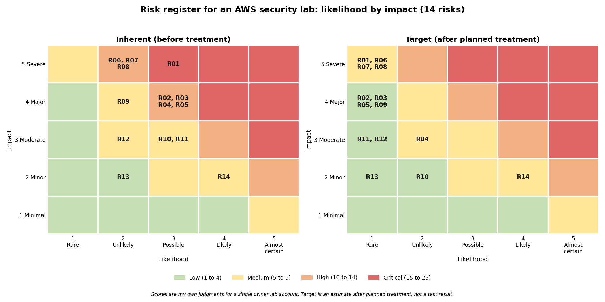

# Risk Register for an AWS Security Lab

A scored risk register for my personal AWS lab, built from the real results of Projects 3 and 4. Each risk has lab evidence behind it, a mapping to NIST CSF 2.0 and NIST SP 800-53, a treatment decision and a target score. Completed 2026-10-13.

## Objective
Show how findings from hands on security work turn into a risk register that a manager can read: what could go wrong, how likely and how bad, what control addresses it, and what I decided to do about it.

## Scope
1. One personal AWS lab account used in Projects 3 and 4. No production systems and no employer data.
2. Assets in scope: the S3 bucket, IAM users and access keys, IAM policies, the root account, CloudTrail logs, and the screenshots, posts and repo that document the work.
3. Not in scope: any system I do not own.

## Method
1. Listed the lab assets and asked what could go wrong with each.
2. Wrote each risk as a plain sentence and attached the lab evidence that made it real.
3. Scored likelihood and impact from 1 to 5. Score is likelihood times impact. Bands: Low 1 to 4, Medium 5 to 9, High 10 to 14, Critical 15 to 25.
4. Mapped each risk to a NIST CSF 2.0 function and category and to NIST SP 800-53 Rev. 5 controls.
5. Chose a treatment (reduce, accept, avoid or transfer) with a reason, recorded the control status honestly, and set a target score for after treatment.

## Results

| Rating | Before treatment | Target after treatment |
| --- | --- | --- |
| Critical | 1 | 0 |
| High | 7 | 0 |
| Medium | 5 | 6 |
| Low | 1 | 8 |
| Total | 14 | 14 |

Treatment decisions: 12 reduce, 1 avoid, 1 accept, 0 transfer.

The highest scored risk is a public S3 bucket (R01, score 15). Block Public Access was on for all four settings in Project 3, and a public read policy was refused and logged in CloudTrail. The control works, but the impact of a failure is severe, so the risk stays at the top of the register until a change alert exists (R08).

## Control status, stated plainly
1. Implemented and tested in the lab: R01, R03, R06 (checked by the access review script), R12, R13.
2. Implemented as a rule or checklist: R05, R07.
3. Tested in the policy simulator on a test user but not yet applied to real users: R02.
4. Detection built, disabling is a manual step: R04.
5. Partly in place: R09 (trail works, separate log bucket and log file validation are planned).
6. Known limit documented: R11.
7. Planned and not built: R08 and R10.
8. Accepted: R14.

Target scores for planned controls are estimates of where the score should land once the control exists. They are not test results.

## Limits
1. Likelihood and impact are my own judgments for a single owner lab. They are not measured values and another reviewer could score them differently.
2. The register covers a small lab. It shows the method, not the risk of any real organization.
3. Evidence comes from Projects 3 and 4 only. R04 uses the simulated review date from Project 4, which is labeled as simulated in that project.
4. Control mappings are my study mappings, not an official NIST crosswalk.
5. A real register also needs business context: who owns each asset, what the data is worth, and the risk appetite of the organization.

## Files
1. risk_register.xlsx: the register with formulas for scores and ratings, a Method sheet with the scales and bands, and a Heat map sheet.
2. risk_register.csv: a plain copy of the register for reading on GitHub.
3. heat_map.png: likelihood by impact, before and after treatment.
