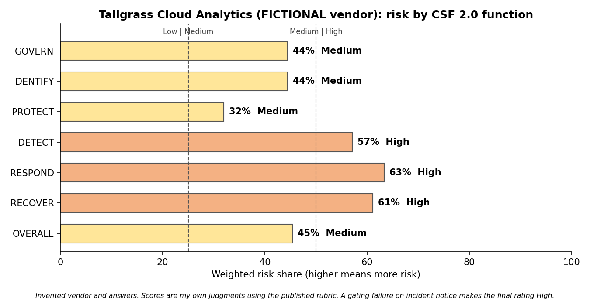

# Vendor Security Questionnaire and Risk Scoring

A 30 question third party security questionnaire, a scoring rubric, and a worked assessment of a fictional cloud vendor. Built to show how a security team turns vendor answers into a clear rating and contract conditions. Completed 2026-10-13.

## The vendor is fictional
Tallgrass Cloud Analytics is an invented company. Every answer in the assessment was written by me for this exercise. It is not based on any real vendor, and nothing here describes a real company.

## Objective
Show a repeatable way to assess third party security risk: ask consistent questions across the NIST CSF 2.0 functions, score the answers with a transparent rubric, and turn the gaps into contract clauses and a short recommendation a manager can act on.

## Method
1. Wrote 30 questions across the six CSF 2.0 functions (5 Govern, 4 Identify, 11 Protect, 3 Detect, 4 Respond, 3 Recover). Each is mapped to a CSF category and a NIST SP 800-53 control.
2. Gave each question a weight of 1 to 3 for how much it matters to protecting the customer's data.
3. Scored each answer from 0 to 3: 0 in place with evidence, 1 in place but no evidence, 2 partly in place or weaker than required, 3 not in place or no answer.
4. Calculated the weighted risk share (weighted points divided by the maximum possible) and set bands: Low up to 25 percent, Medium up to 50 percent, High above that.
5. Marked four questions as gating. If any gating question scores 3, the vendor is rated High regardless of the weighted share.
6. Wrote the contract clauses that close the gaps and a one page summary for an executive.

## Results for the fictional vendor

| Function | Weighted risk share | Band |
| --- | --- | --- |
| Govern | 44 percent | Medium |
| Identify | 44 percent | Medium |
| Protect | 32 percent | Medium |
| Detect | 57 percent | High |
| Respond | 63 percent | High |
| Recover | 61 percent | High |
| Overall | 45 percent | Medium |

Gating check: one gating question scored 3. The vendor's standard terms allow 7 days to report a data incident, and the rubric requires 72 hours. The final rating is High.

Recommendation: do not approve as written. Approve only if the vendor accepts the must have contract conditions.

The most useful lesson was the gap between the average and the gate. The weighted score alone says Medium. The gating rule is what keeps one critical failure from hiding inside a decent average.

## Contract conditions
The workbook lists ten clauses, each tied to the questions that triggered it. Five are must have: incident notice within 72 hours, a SOC 2 Type II report within 6 months, a right to audit, data return and certified deletion within 30 days, and a current subprocessor list with change notice. These are not legal advice. A lawyer should draft the actual terms.

## Limits
1. The vendor and its answers are invented. The scores show the method, not the quality of any real company.
2. Weights, bands and gating questions are my own choices for a mid sized company buying a cloud analytics service that holds internal business data. Another team could reasonably choose differently.
3. Scoring answers is not the same as testing controls. A real assessment would review the evidence itself and may include a technical review.
4. The questionnaire does not cover privacy law, financial health of the vendor or concentration risk.
5. Control mappings are my study mappings to NIST CSF 2.0 and SP 800-53 Rev. 5, not an official crosswalk.

## Files
1. questionnaire.md: the 30 questions, readable on GitHub.
2. vendor_assessment.xlsx: the rubric, a blank questionnaire to send to a vendor, the worked assessment with formulas, risk by function, and the contract clauses.
3. vendor_risk_summary.pdf: the one page executive summary.
4. risk_by_function.png: the chart used in the summary.
